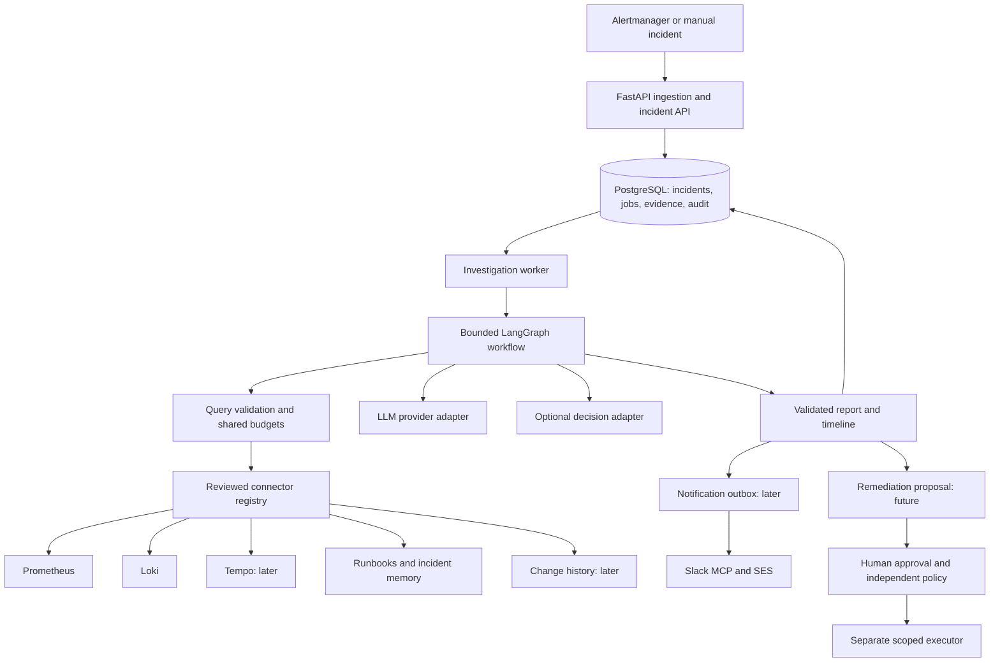

# AI SRE Agent: Implementation Plan

Current implementation and verification are tracked in [docs/implementation-status.md](docs/implementation-status.md). The full-stack code now spans the roadmap, while real-provider, external-user and production acceptance gates remain explicit. The milestone descriptions below remain the design and acceptance baseline.

Planning date: 27 October 2026. Source: `AI_SRE_Agent_PRD.docx`, version 0.1, dated 26 October 2026. This is a proposed plan, not an implementation status report or a delivery commitment.

Implementation update (27 October 2026): M0's API/database foundation is implemented: validated settings, pinned direct runtime dependencies, package boundaries, explicit checksummed migrations, incident retrieval/pagination, readiness and isolated PostgreSQL tests. CI and contribution templates are configured. Local validation passed 22 tests and lint checks; hosted CI and other Python environments have not yet been run. No live model/Jev integration has been selected or verified. Existing application data has not been migrated automatically. See [the current setup guide](docs/getting-started.md).

## 1. First release outcome

Product direction: an open-source, self-hosted incident investigation tool for developers and small platform teams. The local incident lab is the onboarding and evaluation environment; connecting an existing service's observability stack is the intended practical use. The initial deployment model is one trusted team per installation.

The initial audience is developers who already expose Prometheus metrics and can provide Loki logs. Start with this explicit compatibility boundary rather than promising support for every observability stack. The value proposition is: turn an alert into an inspectable, evidence-linked investigation using your own infrastructure and configured model provider.

Given a reproducible failure in a local sample service, the system receives an Alertmanager webhook, persists an incident, retrieves relevant Prometheus metrics and Loki logs, and produces a structured investigation report with evidence references, ranked hypotheses, uncertainty, and suggested next steps. An engineer can retrieve the incident and report through the API.

An investigation report does not mark an operational incident resolved. No production remediation is included. Swagger UI and Markdown/JSON reports are sufficient for the first release; a custom frontend is deferred.

Two documented user journeys are required: run a bundled demo with synthetic telemetry, then configure an existing Prometheus/Loki installation without running the demo service. Demo fixtures must work without paid API credentials; live AI investigation requires an explicitly configured, verified provider. Fixture output must be clearly labeled and must never masquerade as a live model result.

## 2. Current repository versus required system

| Area | Present today | Work required |
| --- | --- | --- |
| API | FastAPI, manual incident creation, liveness route | Alertmanager parsing, authenticated ingestion, retrieval, pagination, status/report endpoints |
| Persistence | PostgreSQL connection pool and incident insert | Migrations, configuration, events, deduplication, investigations, evidence, reports, jobs |
| Metrics | HTTP counter/histogram, Prometheus scrape configuration | Alert rules, Alertmanager, read-only query adapter, workflow telemetry |
| Logs | Application console logging | Structured application logs, collector, Loki, read-only query adapter |
| Failure simulation | `/slow` and `/crash` | Separate sample service, repeatable traffic, resettable scenarios, expected evidence |
| Agent | Not implemented | LangGraph workflow, provider interface, typed outputs, evidence validation, budgets |
| Quality | No automated test suite or benchmark in repository | Contract/integration tests, reproducible scenarios, baseline, adversarial cases |
| Packaging | Incomplete `requirements.txt` | Complete dependency manifest, tested versions, `.env.example`, reproducible startup |

Existing uncommitted changes must be preserved. Refactor incrementally and keep `main:app` usable during the transition.

## 3. Proposed design decisions

- Keep FastAPI and PostgreSQL. Use versioned SQL migrations and a small repository layer; avoid changing database abstractions without a concrete need.
- Use one LangGraph workflow with typed provider adapters and deterministic validation around model outputs.
- Start with direct Prometheus/Loki HTTP adapters. Introduce MCP for integrations that need it, rather than requiring it for every connector.
- Use a separate worker process and a PostgreSQL jobs table. Persist incident creation and job enqueueing in one transaction. Claim jobs atomically using leases, with bounded attempts and stale-job recovery. This avoids adding a broker while preserving accepted work.
- Keep graph checkpoints separate from business records. Checkpoints support execution recovery; incident events and evidence provide the application audit history.
- Separate the monitored sample service from the investigator so that fault injection does not disable investigation.
- Use local Markdown runbooks with metadata and deterministic keyword/tag retrieval initially. Add vector retrieval only after evaluation shows a need.
- Treat model ID, SDK, account availability, cost, and data terms as a verification gate. The PRD's model name is not yet a confirmed API dependency. Jev remains optional and cannot block MVP delivery.
- Keep the core workflow independent of a specific paid model or decision service. Ship one verified live model adapter first plus fixture support; document the adapter contract before expanding the provider matrix.
- Provide separate Compose configurations or profiles for the core service and bundled demo. Containerize the API and worker so users can run the first release without installing a Python toolchain; retain a documented native contributor workflow.
- Make outbound data flow explicit. No product analytics or background uploads by default; external model calls and configured notifications are documented user-enabled integrations.

LangGraph provides checkpoint persistence, but job ownership and application transaction guarantees still need application design: [official checkpoint reference](https://reference.langchain.com/python/langgraph.checkpoint). Alert ingestion must handle Alertmanager's grouped webhook payloads: [official Alertmanager configuration](https://prometheus.io/docs/alerting/latest/configuration/).

## 4. Delivery milestones

### M0: Reproducible foundation

Scope: configuration validation, complete dependencies, `.env.example`, migrations, readiness checks, package layout, basic CI, and documented startup. Record provider verification results without committing credentials.

Open-source foundation: document project maturity and supported environments, keep the existing MIT license, and add contribution instructions, issue/PR templates, a code of conduct, and a private vulnerability-reporting process. Document maintainer review responsibilities and avoid implying an enterprise support commitment.

Exit criteria: a clean checkout can start the API and database and create/read an incident using documented commands. Missing configuration produces clear errors. Existing API behavior remains covered during refactoring.

### M1: Working incident lab

Scope: sample service, traffic generator, Prometheus alert rules, Alertmanager webhook, Loki and log collection, scenario setup/reset commands, and initial runbooks.

Start with five scenarios: elevated application errors, slow dependency, database pool exhaustion, configuration failure, and insufficient evidence. Each scenario needs an isolated injection mechanism, known cause, expected signals, cleanup procedure, and a timeout.

Exit criteria: each scenario reproducibly produces the expected telemetry and alert. A normal control run does not produce the same alert. Reset restores the service. Grafana is optional for inspection, not required by the agent.

Onboarding work starts here; the complete gate is verified at M4 after reporting exists: a new contributor can follow the quickstart from a clean clone, run a fixture-backed investigation without a model key, inspect the report, and reset the demo. Aim for a first report within 15 minutes after prerequisites and image downloads; measure this with an external tester before advertising it.

### M2: Durable ingestion and evidence collection

Scope: webhook normalization, deduplication, incident lifecycle, worker/jobs, typed evidence, bounded Prometheus/Loki adapters, audit records, and incident/evidence APIs.

Exit criteria: repeated and grouped webhooks do not launch duplicate active investigations. Accepted work survives worker restart. Connector timeouts yield explicit missing-evidence records. Query limits are enforced before network calls. Resolved alert events are recorded without silently resolving the incident.

### M3: Read-only investigation and reports

Scope: bounded graph, deterministic baseline, model adapter, local runbooks, structured hypotheses, evidence checks, and JSON/Markdown reports.

Proposed graph: normalize context -> plan bounded queries -> collect evidence -> retrieve runbooks -> generate hypotheses -> validate evidence links -> perform at most one additional collection round -> finalize report.

Exit criteria: an injected fault produces a retrievable report with valid evidence references. Missing or conflicting signals can produce `insufficient_evidence`. Invalid model output is rejected or repaired within the same budget. No arbitrary shell or infrastructure write capability is exposed.

Adoption gate: document and test the same workflow against separately configured Prometheus/Loki endpoints. Supply a sample configuration, connectivity checks, severity/label mapping, a sample webhook, and clear missing-connector behavior. An installation using fixture mode is visibly distinguished from live mode.

### M4: MVP evaluation and reliability gate

Scope: replayable benchmark fixtures, baseline comparisons, repeated runs, cost/latency measurements, failure injection against connectors/providers, redaction and prompt-injection tests, and documentation.

Exit criteria: initial scenarios have documented outcomes and limitations, benchmark results are reproducible, worker-crash/retry behavior is tested, and quality thresholds are agreed using measured baseline data. Runbook retrieval is included before MVP sign-off despite its P1 label in the requirements table.

Expand toward 20–30 scenarios, separating held-out cases from prompt-development cases. Use recorded or synthetic fixtures for infrastructure scenarios unavailable in the local lab; label them accordingly.

### Later releases

1. Tempo and trace evidence; Slack MCP and AWS SES with explicit destination configuration, notification deduplication, retries, and separate accepted/delivered statuses.
2. Jev experiment against deterministic and LLM-only baselines, using the same held-out evidence and a written adoption gate for quality, latency, and cost.
3. Incident memory and deployment/change context, retaining provenance and avoiding causal claims from timing alone.
4. Higher concurrency, broader recovery guarantees, and additional connectors based on measured requirements.
5. Separate remediation service with scoped approvals, authorization, preconditions, idempotency, rollback strategy, and post-action checks in non-production first.

M0 -> M1 -> M2 -> M3 -> M4 is the critical path. Calendar estimates should follow M0, once available engineering time and provider access are known.

Public release checkpoints:

| Release | User-visible promise | Gate |
| --- | --- | --- |
| 0.1 alpha | Reproducible self-hosted demo, manual/webhook ingestion, persisted incidents, bounded metrics/log investigation, inspectable reports | M0–M4 complete, documented limitations, release notes, tagged source and container images |
| 0.2 alpha | Easier connection to users' stacks and more reliable developer workflows | Feedback from at least three external trial installations, connector contract tests, tested upgrade/backup instructions |
| Later beta | Broader operational use within a documented support boundary | Repeatable benchmarks, recovery tests, access/data-handling documentation, stable published contracts |

These are proposed gates, not guarantees of production readiness. Trace and notification work can enter subsequent releases as user feedback justifies it; incident remediation remains separately gated.

## 5. Data and API contracts

Proposed records:

| Record | Core fields |
| --- | --- |
| Incident | ID, service, environment, severity, operational status, first/last seen, timestamps |
| Alert event | Source, fingerprint, firing/resolved state, start/end, labels, payload hash, incident ID |
| Investigation | ID, incident ID, execution status, limits, usage, start/end, error, version |
| Evidence | ID, investigation ID, source, observed/retrieved timestamps, bounded query, resources, redacted content, source link |
| Hypothesis/report | Rank, claim, supporting/contradicting evidence IDs, uncertainty, missing evidence, recommendations, version |
| Job | Investigation ID, attempt, lease owner/expiry, next attempt, terminal error |
| Audit event | Correlation IDs, actor, operation, sanitized parameters, outcome, timestamp |

Keep operational status (`open`, `acknowledged`, `resolved`) separate from investigation status (`queued`, `running`, `completed`, `failed`, `cancelled`). Record `insufficient_evidence` as a report outcome, not necessarily an execution failure.

Deduplicate an alert occurrence using source, environment/service context, fingerprint, and start time. Repeated deliveries update last-seen/event information. A new occurrence after resolution can create a new incident. Define manual-request idempotency separately. Enforce concurrency with database constraints, not only in Python.

Proposed routes:

- Retain `POST /incidents` and add `GET /incidents` and `GET /incidents/{id}`.
- Add `POST /webhooks/alertmanager` for grouped firing/resolved events.
- Add `POST /incidents/{id}/investigations` returning HTTP 202 plus investigation ID.
- Add `GET /investigations/{id}`, `/evidence`, and `/report`.
- Retain liveness and metrics; add a separate readiness route.

For webhooks, acknowledge only after persistence commits. Acknowledgment does not mean investigation completion. Document severity mapping and fallback behavior explicitly.

## 6. Initial guardrails and quality checks

Proposed starting limits, configurable and subject to lab measurement: 120 seconds per investigation, 10 tool calls, 4 model calls, one retry per transient operation, 10 seconds per connector call, 15-minute query windows, and 64 KiB normalized evidence per tool result. Enforce an aggregate context limit and provider token budget too. Retries count toward all budgets and remaining wall time. Dollar budgets require verified pricing; unknown pricing must not be reported as zero cost.

Restrict query destinations and operations; validate time ranges, result sizes, query complexity, and tool arguments. Authenticate ingestion, isolate connector credentials, redact before external model calls, and treat retrieved content as untrusted data. Store redacted audit data rather than unrestricted prompts or raw telemetry. Keep the lab on synthetic data until external-data rules are agreed.

Tests should verify meaningful behavior: concurrent deduplication, DB transaction rollback, worker restart, lease recovery, budget exhaustion, malformed output, fabricated evidence IDs, connector outage, secret redaction, and prompt injection through logs/runbooks.

Measure top-1/top-k hypothesis accuracy, claim support, correct abstention, MTTI against a documented manual baseline, tool success, completion, latency, and cost. Do not treat model confidence as calibrated correctness. Ground-truth labels must not enter the investigator's context.

## 7. First implementation backlog

1. Complete dependency/configuration inventory and introduce `.env.example`.
2. Create the initial database migration and persistence tests.
3. Extract configuration, incident schemas, and repositories from `main.py` while preserving the entrypoint.
4. Add incident retrieval and readiness checks.
5. Extract the monitored sample app and add repeatable traffic/failure controls.
6. Add Loki collection and Prometheus/Alertmanager rules.
7. Implement grouped webhook normalization and concurrency-safe deduplication.
8. Implement jobs/worker recovery, then evidence adapters and audit events.
9. Capture the first benchmark fixtures and deterministic baseline before adding model reasoning.
10. Implement and evaluate the bounded graph and report contract.

Create package directories only as they gain working code; avoid scaffolding every future integration now.

## 8. Open-source developer experience and maintenance

### Documentation and examples

- Rewrite the README around what works today: one-sentence purpose, actual report example, quickstart, prerequisites, supported integrations, data flow, and current limitations. Keep proposed capabilities in the roadmap.
- Provide guides for the bundled demo, connecting an existing stack, configuring a model, writing runbooks, adding a connector, troubleshooting, and contributing.
- Publish example alert payloads, redacted reports, runbooks, and benchmark fixtures. Keep secrets and private incident data out of examples and issue reports.
- Document CPU/memory/disk needs after measuring the full demo on a reference machine. State tested host environments and distinguish them from unverified ones.

### Extension contract

Each connector declares name/version, capabilities, configuration schema, required permissions, health check, typed query inputs, normalized evidence outputs, limits, and error categories. Provide a fixture connector and reusable contract tests so contributors can add integrations without a live account or touching the graph internals.

Start with an explicit registry of reviewed connectors. Loading arbitrary third-party Python plugins is equivalent to executing trusted code and is not required for the first release. Keep model-provider and notification contracts separate from evidence retrieval.

### Contribution and release workflow

- Label issues by area and difficulty, with clear expected behavior and acceptance criteria. Good initial contributions include runbooks, fixtures, documentation, and connector contract tests.
- Require CI for formatting/linting, unit tests, database integration tests, and fixture-backed end-to-end investigation. Paid-provider smoke tests are maintainer-triggered and optional for contributors; fork PRs receive no provider secrets.
- Version configuration, schemas, prompts, and report formats. Document breaking changes during 0.x releases and test database upgrades before publishing them.
- Publish tagged source and matching versioned container images, changelog, upgrade steps, and known limitations. Pin demo dependencies to tested releases rather than silently following `latest`.
- Document backups and restore procedures before encouraging users to retain operational incident history. Define configurable retention and deletion behavior.
- Review dependency licenses and redistribution terms before release. Preserve MIT licensing for project code; dependencies and external APIs retain their own terms.

### Adoption signals

Use opt-in feedback, issue reports, and documented user trials to measure time to first report, quickstart completion, successful external-stack connections, recurring setup failures, connector contribution effort, and report usefulness. Stars and downloads are secondary signals; diagnostic quality remains benchmarked separately.

### Scope boundaries

The first release supports a self-hosted single-team deployment. Hosted SaaS, billing, multi-tenancy, a plugin marketplace, a custom dashboard, Kubernetes installation, and autonomous remediation are future product decisions. Prioritize issues that improve the supported developer journey before expanding this scope.

## 9. Decisions to confirm during planning

- Confirmed direction: open-source software for developers, with a self-hosted alpha and a bundled demonstration environment.
- Which LLM provider/account is available, and what spending limit is acceptable? Provider-backed work remains gated on this; the lab and deterministic baseline can proceed independently.
- How much weekly development time is available? Use that to estimate the milestones rather than promise dates now.
- What telemetry may leave the machine, and what retention policy applies? Until decided, use synthetic lab data only and configurable retention.
- Which official Jev API documentation and account are intended? Defer implementation until these are available and verified.

This planning pass reviewed the PRD and repository source. It did not run the lab, verify the proposed model/Jev account availability, or change application behavior.

## 10. Full PRD requirement coverage

M0–M4 describe the first release. M5–M12 below cover the remaining PRD scope. All acceptance statements are future gates, not claims about existing functionality.

| PRD ID | Delivery | Implementation and acceptance evidence |
| --- | --- | --- |
| FR-01 Alert ingestion | M2 | Validate manual and grouped Alertmanager payloads; reject malformed/oversized input; contract tests cover firing and resolved alerts. |
| FR-02 Incident identity | M2 | Stable event identity, unique constraints, concurrent duplicate-delivery tests, documented recurrence policy. |
| FR-03 Incident state | M0, M2 | Persist state transitions, timestamps and failures; incident retrieval reflects history after restart. |
| FR-04 Evidence retrieval | M2 | Bounded read-only Prometheus/Loki queries; timeouts, invalid arguments, outages and oversize responses tested. |
| FR-05 Provenance | M2 | Evidence IDs retain source, observation time, retrieval time, query, relevant resources and source links where available. |
| FR-06 Bounded workflow | M3 | Central step/call/token/deadline accounting; retries and output repairs cannot bypass limits. |
| FR-07 Hypotheses | M3 | Ranked hypotheses reference supporting and contradicting evidence; invalid references are rejected. |
| FR-08 Uncertainty | M3, M4 | Explicit insufficient-evidence report with missing signals and next useful queries; ambiguous benchmark cases test abstention. |
| FR-09 Report | M3 | Versioned JSON and Markdown report includes timeline, scope/impact, hypotheses, evidence, recommendations and limitations. |
| FR-10 Audit | M2 onward | Correlated tool/model/report events, bounded sanitized parameters, outcomes and errors; redaction tests. |
| FR-11 Runbooks | M1, M3 | Local retrieval with document/version references; sourced instructions visibly distinct from generated suggestions. |
| FR-12 Slack | M5 | Approved destination configuration, restricted MCP integration, deduplicated updates, retries and provider-status recording. |
| FR-13 Email | M5 | SES sender/recipient configuration, severity routing, sanitized report, message ID and delivery-event correlation where configured. |
| FR-14 Traces | M6 | Tempo adapter returns bounded normalized trace evidence with trace/span IDs and timing; outage and partial-trace tests. |
| FR-15 Decision adapter | M7 | Provider-neutral typed decision interface; Jev verification and comparative experiment; unavailable Jev does not break baseline. |
| FR-16 Benchmark | M1, M4, M7 | Repeatable known/ambiguous scenarios, labeled ground truth, held-out cases, measured baselines and exported results. |
| FR-17 Incident memory | M8 | Authorized historical retrieval with provenance, retention and deletion; relevance comparison against keyword baseline. |
| FR-18 Change correlation | M9 | Read-only deployment/commit evidence, source links and corroboration; coincidental change fixtures cannot be asserted as proven cause. |
| FR-19 Approval | M11 | Authenticated, scoped, expiring approval bound to an exact action version; altered/replayed/revoked approval tests fail closed. |
| FR-20 Remediation | M11 | Separate executor enforces permissions, preconditions, idempotency and verification; initial actions tested only in non-production. |

## 11. Target architecture and module boundaries



The investigation worker receives no executor credentials. Connectors cannot authorize remediation. Model-generated tool requests pass through application validation before dispatch. Operational status changes remain explicit business operations, independent of model conclusions.

Proposed repository layout, introduced incrementally:

```text
main.py                       # compatibility entrypoint
src/ai_sre_agent/
  api/                        # routes, auth, request/response schemas
  config/                     # validated settings and config versions
  incidents/                  # lifecycle, events, repositories
  worker/                     # jobs, leases, recovery
  agent/                      # graph, state, nodes, prompts, budgets
  evidence/                   # normalization, provenance, redaction
  providers/                  # llm and optional decisions
  integrations/               # metrics, logs, traces, knowledge, changes
  reports/                    # validation, timeline, renderers
  notifications/              # outbox, routing, channel adapters
  policies/                   # deterministic query/action policies
  observability/              # structured logs, metrics, workflow tracing
migrations/
examples/                     # demo app, runbooks, alerts, configuration
evaluation/                   # fixtures, ground truth, runner, scoring
tests/                        # unit, contract, integration, end-to-end
infra/                        # core/demo Compose and later deployment files
docs/                         # architecture, user and contributor guides
.github/                      # CI and issue/PR templates
services/remediation/         # future separate executor boundary
```

Do not create empty directories for future modules. Choose final packaging and supported Python versions in M0 and verify them in CI.

### Core contracts

- Connector request: service/environment, bounded time range, allowed query/template, result limits, remaining deadline and correlation IDs.
- Connector result: evidence list, truncation indication, sanitized error category, source health and usage; empty results are different from failed queries.
- Model request: versioned task schema, redacted evidence, allowed tools, remaining limits and prompt version. Response: typed output plus provider usage metadata.
- Report: schema version, incident/investigation IDs, execution mode, evidence cutoff, facts, hypotheses, contradictions, limitations, recommendations and provenance.
- Error categories: invalid input, unauthorized, unavailable, timeout, rate limited, budget exhausted, invalid model output and internal failure. Retry only eligible transient categories within the original budget.

## 12. Complete later-phase implementation backlog

### M5: Timeline and notification delivery

Dependencies: persisted reports and audit events from M2–M4.

Build a timeline projection from immutable incident/investigation events. Implement a notification outbox written transactionally with the event that triggers it, delivery attempts, exponential backoff with a cap, destination routing, dead-letter visibility, and an explicit resend operation. Dedupe on incident, event/report version, destination and notification type.

Add Slack MCP and AWS SES adapters independently. Templates include severity, service, summary, uncertainty and authenticated report links; raw logs are excluded by default. Installation administrators explicitly enable destinations and routing. Whether each update needs separate human approval is a documented installation policy, distinct from remediation approval.

Acceptance: duplicate worker execution produces one logical notification, failed sends remain visible/retryable, invalid destinations fail clearly, and API acceptance is not labeled final delivery. Test mocked providers in ordinary CI; live sends occur only to explicitly configured test destinations.

### M6: Trace evidence

Dependencies: connector contract and evidence provenance.

Instrument the demo service and dependency, add Tempo and a tested telemetry pipeline, preserve trace IDs in logs, and implement bounded trace retrieval. Add timeout/error-span scenarios and metrics/log/trace correlation by service, time and trace identifiers.

Acceptance: a downstream-timeout scenario can cite relevant spans; clock skew, missing sampling coverage and incomplete traces are reported as limitations. Trace collection failure still permits a partial report. Register trace fixtures in the same benchmark runner.

### M7: Optional decision experiment

Dependencies: verified Jev documentation/account, stable baseline, held-out benchmark.

Implement the generic decision schema before the Jev-specific adapter. Evaluate classification, next-query selection, hypothesis ranking and evidence sufficiency separately. Compare rules-only, LLM-only and LLM-plus-Jev on identical input evidence and repeated runs.

Record provider/model versions, seeds where supported, dataset version, per-task correctness, abstention, consistency, latency and cost. Predeclare adoption criteria after baseline measurement and before inspecting held-out results. Keep the feature disabled if it fails the gate; publishing a negative result completes the experiment.

### M8: Incident memory

Dependencies: versioned reports, data retention rules and service/environment authorization.

Index approved historical reports and postmortems with source version, incident outcome and provenance. Establish a keyword baseline, then evaluate PostgreSQL/pgvector retrieval if warranted. Keep embedding provider configurable and handle reindexing/version changes explicitly.

Acceptance: retrieval respects installation/service access scope, deleted/expired records leave retrieval indexes, reports distinguish historical similarity from current evidence, and prior incorrect hypotheses are not promoted as verified facts. Test empty history, stale documents and incompatible embedding versions.

### M9: Change and infrastructure intelligence

Dependencies: extension contract, permission checks and correlation evaluation cases.

Add read-only GitHub commit/release context first, followed by one deployment source selected from real adopter needs. Integrate Jenkins/Argo CD through the same contract as demand warrants. Add Kubernetes events/restarts/resource context and Docker context as separately enabled connectors; do not mount an unrestricted container socket into the agent by default.

Acceptance: evidence includes repository/resource identity, environment, timestamp and source URL. A nearby deployment is only a candidate cause until corroborated. Unauthorized resources and missing deployment history yield explicit gaps. Each integration ships fixtures, contract tests and scoped-permission documentation.

### M10: Scale and resilience

Dependencies: measured queue depth, investigation duration and recovery behavior.

Measure before changing the queue. Add worker concurrency controls, per-connector/model rate limits, backpressure, cancellation, stale-lease recovery, dead-letter operations and failure dashboards. Use Kafka only if measured throughput, replay or independent-consumer requirements justify its operational cost; document migration from existing jobs if adopted.

Acceptance: concurrent workers cannot commit conflicting report versions, retry storms are bounded, expired workers cannot overwrite newer attempts, and a process crash does not lose accepted incidents. Publish load-test hardware/workload/results and supported limits. Do not promise exactly-once external side effects; use idempotency and reconciliation.

### M11: Human-approved remediation

Dependencies: authenticated operator roles, audit integrity, reliable workflow state and a documented threat model. This phase is independent of read-only release maturity.

Represent a proposal as an immutable action type, exact target/environment, parameters, evidence, risk, preconditions, expiry, expected effect, verification and rollback/containment plan. Bind approval to its digest/version. The executor independently checks policy, identity, target permissions, expiry, revocation, preconditions and idempotency before execution. Evaluate OPA behind a policy interface if policy complexity warrants it.

Start with a narrowly scoped reversible action in the local lab, such as restarting only the allowlisted demo workload. No arbitrary shell action. Record execution attempts, external operation IDs, results and post-action health; ambiguous execution results require reconciliation rather than blind retries.

Acceptance: missing, expired, modified, replayed or wrong-target approvals cannot execute; duplicate requests do not repeat the logical action; failed verification triggers the documented containment/rollback path. Production enablement requires a separate readiness decision and operator configuration.

### M12: Production deployment and integration expansion

Dependencies: a defined support boundary, security review, recovery/load evidence and documented operational ownership.

Package a repeatable Kubernetes deployment with separated identities, network access, secret injection, storage, probes, resource requests/limits and migration handling. Document TLS/authentication, backups/restores, retention/deletion, incident response for the agent itself, upgrade compatibility and rollback procedures. Production read-only deployment can mature before remediation is enabled.

Expand connector coverage in response to user demand: Datadog, New Relic, CloudWatch, Elasticsearch/OpenSearch, Sentry, Jaeger/Zipkin and broader OpenTelemetry inputs; then PagerDuty/Jira and other delivery channels. Each connector has an owner/support status and the same conformance requirements. Multiple specialized investigators and dynamic tool discovery remain experiments requiring benchmark benefit and a reviewed permission model.

Acceptance: deployment, database restore and upgrade are reproduced in a clean environment; published limits match tests; no known release-blocking security issue remains. Multi-tenancy requires a separate isolation design before it can be advertised.

## 13. Evaluation specification

The 20–30 scenario target is a full benchmark goal, not a claim that all scenarios require Kubernetes in the first release.

| Scenario family | Coverage progression | Expected discriminator |
| --- | --- | --- |
| HTTP 5xx | M1 live lab | Error metrics plus relevant exception evidence |
| Database pool exhaustion | M1 live lab | Pool acquisition/wait signals distinguish it from generic database slowness |
| Downstream timeout | M1 logs/metrics; M6 traces | Identify failing dependency only when attributable evidence exists |
| Configuration error | M1 live lab | Explicit validation/startup failures linked to affected service |
| Ambiguous/healthy control | M1 onward | Abstention or no-incident behavior rather than fabricated cause |
| High CPU | M4 fixture; later live resource lab | Saturation with workload context, not latency alone |
| Memory pressure/OOM | M4 fixture; M9 infrastructure | Resource signals and restart/termination reason |
| CrashLoopBackOff | M4 fixture; M9 Kubernetes | Events, previous logs and startup/runtime distinction |
| Deployment regression | M4 fixture; M9 live change source | Change timing plus corroboration, including coincidental-change controls |
| Network failure | M4 fixture; later live lab | Connection failures plus dependency/network context |

Give each family variants with missing evidence, conflicting evidence and provider failure as appropriate. Every fixture records scenario ID/version, injection/reset, expected evidence, acceptable hypotheses, expected abstention, evaluation rubric and whether data is live, synthetic or recorded. Freeze held-out cases before tuning prompts.

Report denominators and uncertainty with benchmark metrics. Separate citation existence from whether the evidence actually supports the claim; use a human-reviewed rubric for causal support. Track correct abstention separately from raw top-1 accuracy. Define MTTI from receipt to an actionable report and document manual comparison conditions. Record tool-call, model-call and retry counts alongside latency and verified cost.

Structural release gates can be strict immediately: valid schemas, references to actual retrieved evidence, no secret leakage in test fixtures, no accepted-work loss under tested crashes, and no unauthorized writes. Diagnostic quality thresholds must be set after baseline measurement and frozen before the release evaluation.

## 14. Non-functional requirements as deliverables

| Concern | Required work | Validation |
| --- | --- | --- |
| Reliability | Partial reports, bounded retries, durable acceptance, recovery | Connector outage, DB failure and process-crash tests |
| Latency | First-update/final-report timestamps, p50/p95 by scenario | Repeated lab runs with cold/warm state documented |
| Scalability | Concurrency caps, queue age, backpressure | Load tests and resource measurements before published limits |
| Observability | Correlation IDs, graph/tool spans, usage, queue and notification metrics | Debug one failed investigation from telemetry alone |
| Security/privacy | Auth, least privilege, query destination control, redaction, retention | Adversarial fixtures, credential review and deletion tests |
| Maintainability | Typed/versioned contracts, small adapters, conformance suite | Add a fixture connector without graph changes |
| Portability | Core/demo separation, documented host support | Clean-start tests on declared supported environments |
| Cost | Shared budgets, verified usage/pricing metadata, limits | Repeated/repaired outputs cannot bypass budgets |
| Recovery | Checkpoints, leases, fencing/version checks, backup/restore | Restart during tool/report execution; restore persisted incidents |

Query credentials may access user-designated private observability endpoints; guard against model-controlled destinations and redirects without blocking the installation's explicitly configured private network. Retention must cover evidence, prompts where retained, checkpoints, reports, audit logs and backups, not just incidents.

## 15. Planning dependencies, decisions and risks

The core dependency chain is M0 -> M1 -> M2 -> M3 -> M4. M5/M6 can follow independently once core contracts are stable. M7 requires the benchmark and verified Jev access. M8/M9 depend on provenance and access control. M10 follows measurements; M11 follows safety prerequisites; M12 can deliver read-only production packaging without waiting for remediation.

Maintain short architecture decision records for persistence/migrations, queue/recovery semantics, provider selection, checkpoint storage, connector trust, external-data rules and API compatibility. Each records alternatives, the chosen approach, tradeoffs, and a revisit trigger.

| Risk | Mitigation and completion evidence |
| --- | --- |
| Scope exceeds maintainer capacity | Release gates, explicit supported integrations, smaller reviewed milestones |
| Model or Jev unavailable | Fixture/deterministic development, provider interface, optional Jev |
| Plausible but wrong report | Supported-claim rubric, contradictions, abstention and held-out tests |
| Prompt injection or data exposure | Untrusted-input boundary, deterministic tool controls, redaction and adversarial tests |
| Lost or duplicated work | Transactional enqueue/outbox, unique keys, leases, attempt fencing, recovery tests |
| Irreproducible user setup | Pinned/tested dependencies, clean-clone quickstart and external trials |
| Abandoned integrations | Named maintainer/support status, fixtures and conformance CI |
| Unsafe future actions | Credential separation, immutable proposals, independent approval/policy/executor checks |

For capacity planning, break each milestone into reviewable issues with dependencies and acceptance criteria. Estimate after foundation discovery using the maintainer's actual weekly availability. Treat provider verification, external trial feedback and deployment security review as explicit dependencies rather than assuming calendar time resolves them.

## 16. Definition of done and first concrete delivery

A feature is done when its behavior meets the linked FR acceptance criteria, meaningful tests pass, failure behavior and data handling are documented, configuration/examples are updated, and its milestone's clean-install path still works. A public release additionally needs benchmark results, changelog, migration/upgrade notes, supported-environment statement and known limitations.

First delivery: M0 only, in small reviewable changes. Inventory and preserve the existing database, add configuration/dependency completeness, introduce a reviewed migration path, extract application boundaries without breaking `main:app`, add incident retrieval/readiness, and establish CI. Do not automatically recreate or delete a developer's existing database to make setup pass.

This full roadmap plans every PRD functional requirement. Optional vendors, additional connectors, production writes and deployment maturity remain explicitly gated rather than being bundled into v0.1.
