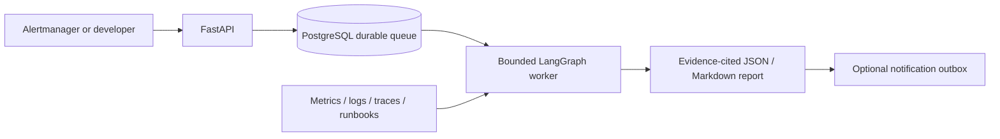

# AI SRE Agent

Self-hosted incident investigation for developers: receive an alert, gather bounded operational evidence, and produce an inspectable report with hypotheses and uncertainty.

**Development status:** a runnable local stack is implemented. The default analyst is a deterministic baseline; OpenAI reasoning and Jev decisions are optional adapters. This is not a production-ready release. See [implementation status](docs/implementation-status.md) for verified behavior and outstanding gates.

## Quickstart

Requires Python 3.10+, Docker and Compose v2. In PowerShell, from the repository root:

```powershell
python -m venv .venv
.\.venv\Scripts\Activate.ps1
python -m pip install -c constraints.txt -r requirements-dev.txt
python -m ai_sre_agent.bootstrap
docker compose --env-file .env -f infra/compose.yml --profile demo up -d --build
python -m ai_sre_agent.cli investigate --scenario database_pool
```

On Linux/macOS, activate with `source .venv/bin/activate`. Bootstrap preserves existing database configuration and creates private local lab tokens under ignored `.demo/`. The default fixture report needs no paid API key. The lab uses its own database volume and does not migrate an existing root Compose database automatically.

Read [the full-stack guide](docs/full-stack-quickstart.md) for actual failure injection, live local metrics/logs/traces, existing-stack setup and authentication. API health is at `http://localhost:8010/health`; Prometheus is at `http://localhost:9091`.

## Implemented workflow



- Validated incidents, grouped alert deduplication, separate operational/investigation states and audit timeline.
- Read-only Prometheus/Loki evidence, optional Tempo/GitHub/Kubernetes context, local runbooks and scoped historical reports.
- Persisted call budgets, deadlines, bounded responses, worker leases, cancellation and stage recovery.
- Ranked hypotheses with actual evidence IDs, contradictions, missing evidence and an insufficient-evidence outcome.
- Optional OpenAI structured analysis, Jev sufficiency evaluation, Slack MCP and AWS SES adapters.
- A separate, disabled-by-default executor supporting only approved local-demo resets.

No production remediation, arbitrary shell execution, hosted SaaS or multi-tenant isolation is provided.

## Developer commands

```powershell
python -m pytest -q
python -m ruff check .
python -m ruff format --check .
python -m ai_sre_agent.evaluate --output artifacts/benchmark.json
```

Set `TEST_DATABASE_URL` privately for PostgreSQL integration tests; otherwise they skip. Thirty synthetic scenario variants test known signatures and abstention, not general diagnostic accuracy. CI runs database tests and a container build without paid model credentials.

For native development, run `python -m ai_sre_agent.migrate`, `python -m uvicorn main:app --reload`, and `python -m ai_sre_agent.worker` with configured PostgreSQL credentials. See [native setup](docs/getting-started.md).

## Documentation

- [Full-stack quickstart](docs/full-stack-quickstart.md)
- [Architecture and connector contracts](docs/architecture.md)
- [Operations, recovery and Kubernetes deployment gates](docs/operations.md)
- [PRD implementation status](docs/implementation-status.md)
- [Complete project plan](PROJECT_PLAN.md)
- [Contributing](CONTRIBUTING.md), [conduct](CODE_OF_CONDUCT.md), [security](SECURITY.md), [changelog](CHANGELOG.md)

Licensed under [MIT](LICENSE). Dependencies and external services retain their own licenses and terms.
