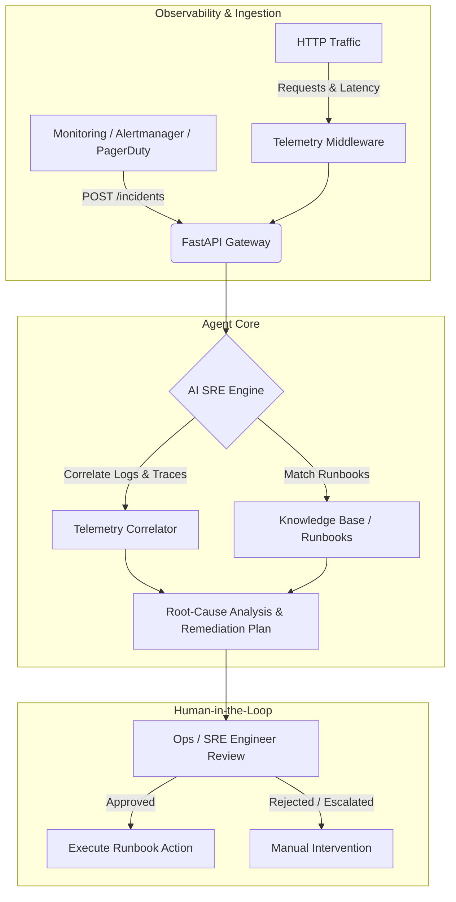

> Development status: the M0 API/database foundation is implemented. For current setup, migrations, retrieval endpoints and tests, see [the development quickstart](docs/getting-started.md). AI investigation and the broader architecture below remain planned; see [PROJECT_PLAN.md](PROJECT_PLAN.md).

# 🤖 AI-SRE-Agent

[](https://opensource.org/licenses/MIT)
[](https://www.python.org/)
[](https://fastapi.tiangolo.com)
[](https://github.com/MuditTandon20/AI-SRE-Agent/pulls)

An intelligent Site Reliability Engineering (SRE) agent designed to automate incident response workflows. The agent triages alerts, correlates telemetry (metrics, logs, traces), diagnoses root causes, and proposes runbook-based remediations with **human-in-the-loop** approval.

---

## 📌 Table of Contents

- [Overview](#-overview)
- [Architecture & Workflow](#-architecture--workflow)
- [Key Features](#-key-features)
- [Tech Stack](#-tech-stack)
- [Project Structure](#-project-structure)
- [Getting Started](#-getting-started)
  - [Prerequisites](#prerequisites)
  - [Installation](#installation)
  - [Running the Server](#running-the-server)
- [API Reference](#-api-reference)
  - [Endpoints](#endpoints)
  - [Example Requests](#example-requests)
- [Chaos & Simulation Testing](#-chaos--simulation-testing)
- [Roadmap](#-roadmap)
- [Contributing](#-contributing)
- [License](#-license)

---

## 🔍 Overview

Modern distributed systems generate overwhelming volumes of alerts, logs, and telemetry during incidents. The **AI-SRE-Agent** acts as a virtual on-call co-pilot that:
1. Ingests incident alerts and telemetry in real time.
2. Identifies anomalous latency and failure spikes via automated request logging.
3. Classifies severity levels (`SEV1`, `SEV2`, `SEV3`) and tracks incident symptom paths.
4. Generates contextual diagnoses and guided runbook execution proposals, maintaining safety via explicit human operator confirmation.

---

## 🏗️ Architecture & Workflow



---

## ✨ Key Features

- **FastAPI Core Engine**: High-performance asynchronous REST API backend.
- **Request & Latency Observability Middleware**: Automatically measures execution duration in milliseconds, tracks HTTP status codes, and outputs structured access logs.
- **Incident Ingestion & Schema Validation**: Validated data models powered by Pydantic, enforcing structured severity scoring (`SEV1`, `SEV2`, `SEV3`) and endpoint symptom categorization.
- **Built-in Chaos & Degradation Simulation**: Pre-configured synthetic testing routes (`/crash`, `/slow`) for validating monitoring rules, latency thresholds, and SRE triage pipelines.
- **Interactive Documentation**: Auto-generated Swagger UI and ReDoc specifications available out of the box.

---

## 🛠️ Tech Stack

- **Language**: Python 3.10+
- **Framework**: [FastAPI](https://fastapi.tiangolo.com/)
- **ASGI Server**: [Uvicorn](https://www.uvicorn.org/)
- **Data Validation**: [Pydantic](https://docs.pydantic.dev/)
- **Logging**: Python Standard `logging` with microsecond-precision latency tracking

---

## 📂 Project Structure

```text
AI-SRE-Agent/
├── main.py              # Application entrypoint, FastAPI routes, and telemetry middleware
├── requirements.txt     # Python package dependencies
├── README.md            # Project documentation and guide
├── LICENSE              # MIT License
└── .gitignore           # Git ignore rules
```

---

## 🚀 Getting Started

### Prerequisites

- Python 3.10 or higher
- `git` installed on your local machine

### Installation

1. **Clone the repository**:
   ```bash
   git clone https://github.com/MuditTandon20/AI-SRE-Agent.git
   cd AI-SRE-Agent
   ```

2. **Create and activate a virtual environment**:
   - **Linux / macOS**:
     ```bash
     python3 -m venv .venv
     source .venv/bin/activate
     ```
   - **Windows (PowerShell)**:
     ```powershell
     python -m venv .venv
     .venv\Scripts\Activate.ps1
     ```

3. **Install dependencies**:
   ```bash
   pip install -r requirements.txt
   ```

### Running the Server

Start the development server with live reload:

```bash
uvicorn main:app --reload --host 0.0.0.0 --port 8000
```

Once running, access:
- **API Base URL**: [http://127.0.0.1:8000](http://127.0.0.1:8000)
- **Interactive Swagger Docs**: [http://127.0.0.1:8000/docs](http://127.0.0.1:8000/docs)
- **ReDoc Documentation**: [http://127.0.0.1:8000/redoc](http://127.0.0.1:8000/redoc)

---

## 📡 API Reference

### Endpoints

| Method | Endpoint | Description |
|---|---|---|
| `GET` | `/` | Service root status check |
| `GET` | `/health` | Liveness and health probe |
| `POST` | `/incidents` | Ingests a new incident alert |
| `GET` | `/slow` | Simulates high latency (5-second delay) |
| `GET` | `/crash` | Simulates an unhandled 500 error / service crash |

### Example Requests

#### 1. Ingest an Incident
```bash
curl -X POST "http://127.0.0.1:8000/incidents" \
     -H "Content-Type: application/json" \
     -d '{
       "title": "Database connection pool exhaustion",
       "path": "/api/v1/checkout",
       "symptom": "HTTP 504 Gateway Timeout during checkout spikes",
       "severity": "SEV1"
     }'
```

**Response (200 OK)**:
```json
{
  "received": "Database connection pool exhaustion",
  "severity": "SEV1"
}
```

#### 2. Check Service Health
```bash
curl -X GET "http://127.0.0.1:8000/health"
```

**Response (200 OK)**:
```json
{
  "status": "ok"
}
```

---

## 🧪 Chaos & Simulation Testing

Use built-in failure injection routes to evaluate monitoring alerts and telemetry middleware:

- **Latency Spike Simulation**:
  ```bash
  curl -i http://127.0.0.1:8000/slow
  ```
  *Console Output:*
  ```text
  INFO: method=GET path=/slow status=200 latency_ms=5005
  ```

- **Service Error Simulation**:
  ```bash
  curl -i http://127.0.0.1:8000/crash
  ```
  *Console Output:*
  ```text
  INFO: method=GET path=/crash status=500 latency_ms=2
  ```

---

## 🗺️ Roadmap

- [x] Initial FastAPI service skeleton with telemetry middleware
- [x] Incident ingestion endpoint with severity validation (`SEV1`–`SEV3`)
- [x] Chaos endpoints (`/slow`, `/crash`) for observability testing
- [ ] LLM agent integration (LangChain / LlamaIndex / OpenAI / Anthropic)
- [ ] Multi-source log & metric collector (Prometheus, OpenTelemetry, Grafana Loki)
- [ ] Automated runbook matching and vector search
- [ ] Slack / Discord / PagerDuty incident response bot
- [ ] Interactive human-in-the-loop remediation console

---

## 🤝 Contributing

Contributions are welcome! To contribute:

1. Fork the repository.
2. Create a new branch: `git checkout -b feature/your-feature-name`.
3. Commit your changes: `git commit -m "feat: add your feature"`.
4. Push to the branch: `git push origin feature/your-feature-name`.
5. Open a Pull Request.

---

## 📄 License

This project is licensed under the [MIT License](LICENSE).
